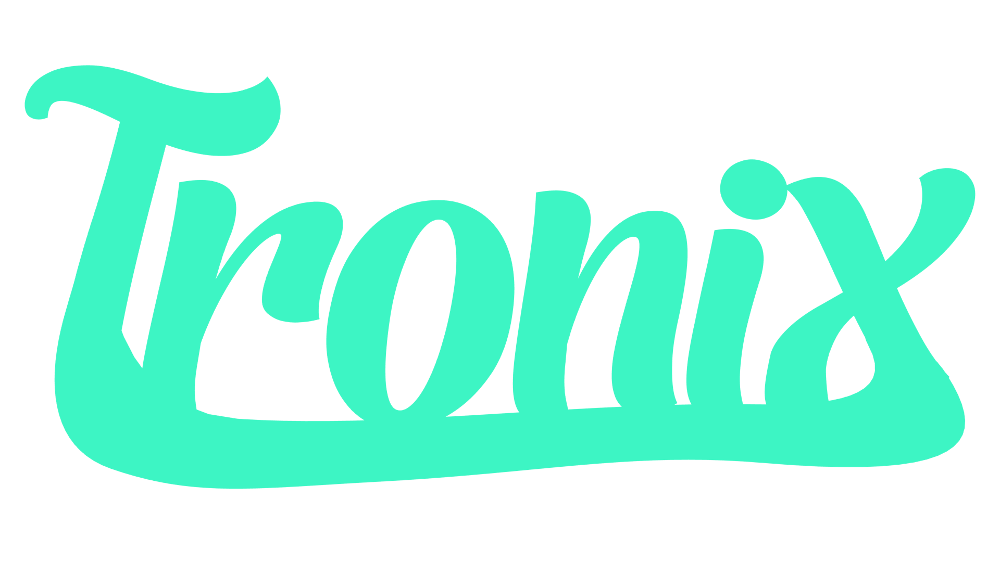

<h1 align="center">
  Tronix Launcher
</h1>

<p align="center">An open-source launcher in the form of a Windows application. It lets you integrate your games from libraries such as Steam, Epic Games Store, GOG Galaxy, Ubisoft Connect, Xbox / Game Pass, EA, Battle.net, and more... all through a single application.</p>

<div align="center">
  
  
  <a href="https://github.com/TommyLPB39/Tronix-Launcher/releases">
    
  </a>
</div>

> [!WARNING]
> # Beta Version
> Tronix Launcher is in **beta**. The launcher may have a few bugs.

## Features
- **Smart Home Screen**: A top suggestion that can be launched with a single click, followed by your library sorted by likelihood (recent use, frequency, usual time). The system learns on your PC, without sending any data.
- **Imports**: Steam, Epic Games Store, GOG Galaxy, Ubisoft Connect, Xbox / Game Pass, EA app, Battle.net, plus the option to manually add any program. You choose which launchers to use.
- **Uninstalled Steam games (free Steam API key, disabled by default)**: collapsible section, “Install” button.
- **Quick Launch**: icon next to the clock (top 5 most likely), global shortcut (Ctrl+Alt+Space by default), and mini search window.
- **Game and software pages (disabled by default)**: description, screenshots, specs, ratings, and news via Steam, RAWG (key), and Wikipedia; editable title and description; choice of cover art from SteamGridDB (key).
- **Statistics**: launches, consecutive days, weekly summary, measured playtime (or estimated and labeled as such).
- **Customization**: dark/light/auto theme, custom accent color, grid or list view, cover art size, corners, blurred background, sorting, favorites, search, filter by launcher, collections.

## Privacy and Security
- No Internet connection at startup. Any network requests (cover art, pages, Steam list) are made only if you enable the setting.
- Your data is stored in %APPDATA%\com.tronix.launcher\. API keys (Steam, RAWG, SteamGridDB) are encrypted there using Windows (DPAPI).
- Tronix never asks for your Steam password: it reads your username from Steam’s files.
- Strict content security policy, minimal permissions, HTTPS only. Details in docs/ARCHITECTURE.md.

## Download Now
<a href="https://github.com/TommyLPB39/Tronix-Launcher/releases">
  
</a>

> [!WARNING]
> # The installer is not signed
> Windows SmartScreen will display a warning (“Windows has protected your computer” → More info → Run anyway). Verify the SHA-256 hash listed in the Release, or compile the project yourself.

## Development
The launcher is primarily developed using the Claude Sonnet 5.5 artificial intelligence model (I prefer to be transparent about this, i take no credit for the development). Anyone who wishes to contribute to the launcher’s development is welcome to do so, as it is open source (all pull request submissions are welcome).

### Compilation

You'll need: [Rust](https://rustup.rs) (2024 edition, Rust ≥ 1.85), [Node.js](https://nodejs.org) (tested with version 24), and the *Visual Studio Build Tools* with the **C++** workload (on Windows).

```powershell
npm install
cargo run --manifest-path src-tauri/Cargo.toml --profile fast   # compiles and runs the application
npx tauri build                                                # builds the installer in src-tauri\target\release\bundle\nsis
```

The files in `src/` are **embedded during compilation**: after making a UI change, rerun the `cargo run` command above. The `fast` profile (defined in `Cargo.toml`) compiles much faster than `release`.

> If Windows refuses to compile due to a path that’s too long (`LNK1104` error), place the build directory near the root: `$env:CARGO_TARGET_DIR = “C:\tronix-target”`.

### Test

```powershell
cargo test --manifest-path src-tauri/Cargo.toml   # Rust core
npm run test:ui                                    # UI (simulated DOM, without a browser)
```

### Modifying the Project

That's what it's for: fork the repository, change whatever you want (UI in `src/`, core in `src-tauri/src/`), and recompile. To help you find your way around:

- [docs/ARCHITECTURE.md](docs/ARCHITECTURE.md): modules, technical decisions, pitfalls.
- [docs/PRD.md](docs/PRD.md): the 86 user stories and the product scope.
- [docs/DESIGN.md](docs/DESIGN.md): the design system.
- [CONTRIBUTING.md](CONTRIBUTING.md): submitting a change.

## License

[MIT](LICENSE) © 2026 Tronix Launcher contributors. Third-party fonts and libraries: see [THIRD_PARTY_NOTICES.md](THIRD_PARTY_NOTICES.md). Tronix Launcher is not affiliated with any of the launchers or services it can read.

